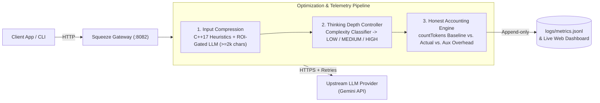

<div align="center">

# ⚙️ Squeeze Gateway

**Transparent Token & Compute Optimization Proxy for Large Language Models**

*Reduce LLM token consumption and latency by **30%–60%** without sacrificing response quality.*

[](LICENSE)
[](https://www.python.org/)
[-00599C?style=for-the-badge&logo=cplusplus&logoColor=white)](core/squeeze.cpp)
[](server.py)
[](https://ai.google.dev/)

[Overview](#overview) • [Benchmarks](#benchmarks--honest-metrics) • [Architecture](#architecture) • [Quick Start](#quick-start) • [CLI & API](#cli-reference) • [Web Dashboard](#web-dashboard--github-pages) • [Roadmap](#roadmap) • [License](#license)

</div>

---

## Overview

**Squeeze Gateway** sits transparently between your application and upstream LLM APIs, cutting redundant prompt bloat and excessive internal model reasoning before tokens are billed. Unlike naive prompt compressors that hide their own compute overhead, Squeeze Gateway enforces **strict net-savings accounting** on every single request:

$$\text{Net Savings} = \underbrace{S_{\text{baseline}}}_{\text{unoptimized request}} - \underbrace{S_{\text{gateway}}}_{\text{routed via gateway}} - \underbrace{S_{\text{aux}}}_{\text{gateway overhead}} > 0$$

### The Problem

Production telemetry collected on **Gemini 3.6 Flash** (October 2026) revealed that typical chat workloads spend **60% to 90% of total tokens on non-answer overhead** rather than the actual response:

* **Conversational filler & boilerplate:** Greetings, politeness padding, and redundant phrasing (*"Hello! Please, if you could, explain to me in detail..."*).
* **Over-thinking on trivial queries:** Excessive internal reasoning tokens—for example, a straightforward factual question (*"What is quantum entanglement?"*) burned **797 thinking tokens** just to generate a **101-token answer**.
* **Uncalibrated compression overhead:** Running a secondary LLM compressor on short prompts often consumes *more* tokens than it saves.

Squeeze Gateway eliminates this waste automatically while leaving dense, complex prompts intact so output quality never degrades.

---

## Benchmarks & Honest Metrics

All benchmarks below were recorded on **`gemini-3.6-flash`** (October 2026) using the reproducible test suite in [`tests/`](tests/), with raw execution telemetry logged in `logs/metrics.jsonl` (see [Verification & Reproducibility](#verification--reproducibility)).

### Net Token Reduction by Workload Profile

```text
Simple Chat ("What is...", "TL;DR...")   [████████████████████████░░░░░░]  ~ -60% net tokens
Mixed Production Traffic (Real-world)    [███████████████████░░░░░░░░░░░]  -40% to -55% net tokens
Study & Work ("Explain why...", QA)      [████████████████░░░░░░░░░░░░░░]  ~ -40% net tokens
Project Target Threshold                 [████████████░░░░░░░░░░░░░░░░░░]  -30% baseline goal
Dense Technical Tasks (Code, raw data)   [██████████░░░░░░░░░░░░░░░░░░░░]  -15% to -30% net tokens
```

### 1. Adaptive Thinking Controller (`?thinking=auto`) — Highest-Impact Lever

| Test Prompt | Thinking Mode | Thinking Tokens | Total Tokens | Latency | Net Impact |
| :--- | :--- | :---: | :---: | :---: | :--- |
| *"What is quantum entanglement?"* | Default (`HIGH`/`AUTO`) | `797` | `918` | `17.3 s` | Baseline |
| *"What is quantum entanglement?"* | **`LOW` (Auto-routed)** | **`386`** | **`493`** | **`6.1 s`** | **`-46%` tokens / `-65%` time** |
| *Bell's Inequality (complex proof)* | `MEDIUM` | `1,229` | `2,630` | `31.9 s` | Baseline |
| *Bell's Inequality (complex proof)* | **`LOW`** | **`1,010`** | **`2,341`** | **`18.4 s`** | **`-11%` tokens / `-42%` time** |

> **How routing works:** The complexity classifier inspects linguistic markers. Analytical prompts containing *"explain"*, *"prove"*, *"solve"*, or *"derive"* retain deeper reasoning budgets to protect accuracy, whereas definitions, summaries, and translations (*"what is"*, *"translate"*, *"briefly"*) are safely routed to `LOW`.

### 2. C++17 Heuristic Prompt Compressor (`core/squeeze.cpp`)

| Prompt Type | Original Input | Compressed Input | Input Savings | Behavior |
| :--- | :---: | :---: | :---: | :--- |
| Verbose conversational query (*"Hi! Please, I need you to..."*) | `63` tokens | **`41` tokens** | **`-35%`** | Strips politeness filler & boilerplate |
| Dense technical prompt (complex task + structured data) | `84` tokens | `79` tokens | `-6%` | Trims minor redundant whitespace |
| Already concise / clean question | `110` tokens *(est.)* | `110` tokens | **`0%`** | **Zero distortion guarantee** |

> **Safety Invariant:** As shown in the final row, when a prompt contains no safe compression candidates, Squeeze Gateway passes it through untouched (`0%` change)—guaranteeing zero semantic loss.

### 3. ROI-Gated Mini-LLM Compression (Break-Even Threshold)

During initial testing, compressing a 63-token conversational prompt with a lightweight LLM reduced the payload to 41 tokens (`-22` tokens saved), **but the compressor itself consumed `333` auxiliary tokens (`aux_tokens`)**—resulting in a net loss of `-311` tokens.

* **Engineering Fix:** LLM-based compression is strictly gated behind a **$\ge 2,000$-character threshold**, activating only on long documents and multi-turn contexts where token savings comfortably exceed compression overhead.

### 4. Summary Across Traffic Profiles

| Traffic Category | Input Compression | Thinking Optimization | Combined Net Savings |
| :--- | :---: | :---: | :---: |
| **Simple Chat** (*definitions, summaries*) | `-30%` to `-35%` | `-46%` | **`~ -60%`** |
| **Study & Research** (*conceptual explanations*) | `-10%` to `-20%` | `-10%` to `-15%` | **`~ -40%`** |
| **Dense Workloads** (*code, structured datasets*) | `-5%` to `-10%` | Untouched (`0%`) | **`-15%` to `-30%`** |
| **Mixed Production Application Traffic** | **Adaptive** | **Adaptive** | **`-40%` to `-55%`** |

---

## Architecture



### Core Pipeline Stages

1. **Input Compression (`core/squeeze.cpp` — C++17 & `pybind11`)**
   * `compress(text)`: Bilingual (EN/RU) deterministic rule engine that strips conversational padding, bureaucratic phrasing, duplicate lines, and redundant blank lines.
   * `estimate_tokens(text)`: Sub-millisecond BPE-empirical token estimator that operates locally without making external API calls.
   * `prefix_hash(text)`: Fast 64-bit FNV-1a fingerprinting prepared for upcoming prefix caching.
2. **Adaptive Thinking Depth Controller**
   * Modern reasoning models expose controllable thinking budgets (`thinkingLevel` in Gemini, `reasoning_effort` in OpenAI, `thinking` in Claude). Squeeze Gateway classifies prompt complexity and conservatively lowers thinking depth only when quality is unaffected.
3. **Honest Telemetry & Accounting**
   * Every request queries the provider's native `countTokens` endpoint on the original payload to establish an exact `baseline`, tracks actual billed tokens plus internal `aux_tokens`, and records net savings in `logs/metrics.jsonl`.

---

## Key Features

* **Drop-In Proxy Transparency:** Compatible with any Gemini API client by changing only the host and port. Append `?squeeze=0` to bypass optimization completely for A/B baseline testing.
* **Respects Explicit Client Configuration:** If an application explicitly sets `thinkingLevel` in the request payload, Squeeze Gateway honors it without interference.
* **Production Resilience:**
  * Exponential backoff retries (`1s / 2s / 4s`) on transient `503 Service Unavailable` spikes.
  * Quota-safe handling of `429 Too Many Requests` errors without burning rate limits.
  * Post-compression validation that automatically rolls back to heuristic compression or the raw prompt if the output is empty or fails to shrink.
* **Real-Time Observability:** Live JSONL audit logs, aggregate `/stats` endpoint, recent `/metrics?limit=8` feed, and a built-in web dashboard.

---

## Quick Start

### Option A: CLI Installation (Recommended)

```bash
# Install from PyPI
pip install squeeze-gateway

# Or install directly from source
git clone https://github.com/kirill-skoch/squeeze-gateway.git
cd squeeze-gateway
pip install -e .
```

Initialize configuration and launch the gateway:

```bash
# 1. Initialize local workspace and configuration
sqz install

# 2. Configure your Gemini API key
sqz config set api_key YOUR_GEMINI_API_KEY

# 3. Start the gateway daemon (default port 8082)
sqz start

# 4. Launch the interactive terminal chat (in a new terminal)
sqz chat
```

### Option B: Manual Build from Source (C++17 Core + FastAPI)

**Prerequisites:** Python 3.12+, CMake $\ge 3.24$, and a C++17 compiler (MSVC on Windows, GCC/Clang on Linux/macOS).

```bash
# 1. Clone the repository and create a virtual environment
git clone https://github.com/kirill-skoch/squeeze-gateway.git
cd squeeze-gateway
python -m venv .venv

# Windows:
.venv\Scripts\activate
# Linux / macOS:
source .venv/bin/activate

# 2. Install Python dependencies and configure environment
pip install -r requirements.txt pybind11
cp .env.example .env   # Add your GEMINI_API_KEY from https://aistudio.google.com/

# 3. Compile the C++17 pybind11 extension
cmake -S core -B core/build -DCMAKE_BUILD_TYPE=Release \
  -Dpybind11_DIR="$(python -c 'import pybind11; print(pybind11.get_cmake_dir())')"
cmake --build core/build --config Release

# 4. Run the gateway server and terminal client
uvicorn server:app --port 8082   # Terminal 1: Gateway
python client.py                 # Terminal 2: Interactive client
```

### HTTP Query Parameters

| Parameter | Values | Description |
| :--- | :---: | :--- |
| `?squeeze=` | `0` / `1` / `2` | `0` = Pass-through baseline, `1` = C++17 heuristic compression, `2` = Heuristic + ROI-gated LLM compression |
| `?thinking=` | `auto` / `low` / `medium` / `high` | Controls adaptive reasoning depth routing |

---

## CLI Reference

| Command | Description |
| :--- | :--- |
| `sqz install` | Initialize configuration files and local directories |
| `sqz start` | Start the Squeeze Gateway proxy server |
| `sqz stop` | Gracefully stop the running gateway instance |
| `sqz status` | Check gateway health, active port, and uptime |
| `sqz chat` | Start an interactive terminal chat session through the gateway |
| `sqz stats` | Display cumulative net token savings and request metrics |
| `sqz config set KEY VAL` | Update configuration parameters (e.g., `api_key`, `port`) |

### Interactive Chat Slash Commands

Inside `sqz chat` or `client.py`, use the following commands to inspect and control optimization on the fly:

| Command | Action |
| :--- | :--- |
| `/mode <auto\|cpp\|llm\|off>` | Switch input compression mode in real time |
| `/thinking <auto\|low\|medium\|high\|->` | Override or reset thinking depth routing |
| `/stats` | Print token savings for the current session |
| `/clear` | Reset conversation history |
| `/exit` or `/quit` | Exit the interactive chat |

---

## Web Dashboard & GitHub Pages

Squeeze Gateway includes a zero-build web dashboard (`HTML/CSS/JS`) powered directly by live gateway telemetry (`/api/summary` and `/metrics`). Once the server is running, open **[http://localhost:8082](http://localhost:8082)** *(interactive OpenAPI/Swagger documentation is hosted at `/api/docs`)*.

| Route | Purpose |
| :--- | :--- |
| `/` | **Live Telemetry Dashboard:** Net input savings, compression ratio, thinking token breakdown, and recent JSONL request logs |
| `/playground` | **Interactive Playground:** Live chat via `generateContent` displaying per-message `baseline`, `actual`, `aux`, thinking level, and latency |
| `/docs` | **Architecture & API Docs:** Pipeline walkthrough, module reference, integration examples, and FAQ |
| `/project` | **Engineering Overview:** Tech stack, design trade-offs, limitations, roadmap, and custom gateway endpoint configuration |

> **Dashboard Accounting Note:** The live dashboard calculates savings strictly from input and gateway overhead tokens (`baseline - actual_input - aux`). Thinking tokens are displayed separately rather than guessed on single requests, since true counterfactual thinking savings require paired A/B execution runs (as shown in the [Benchmarks](#benchmarks--honest-metrics) section).

### Static Showcase Deployment (GitHub Pages)

All frontend asset paths are relative, allowing the static showcase to run seamlessly from a repository subpath (`/<repo>/`):

```bash
python scripts/build_docs.py     # Compiles web/ -> docs/ + .nojekyll
```

In your GitHub repository, navigate to **Settings -> Pages -> Deploy from a branch (`main`, folder `/docs`)**. Open the deployed page and enter your gateway URL under **Project -> Connection** (saved in browser `localStorage`). CORS and `expose_headers` are pre-configured on the gateway. *(Note: Browsers block `http://localhost:8082` requests from an `https://` GitHub Pages origin due to mixed-content policies; use an HTTPS tunnel or run the UI locally at `http://localhost:8082`.)*

---

## Verification & Reproducibility

```bash
# 1. Reproduce thinking-level benchmarks
python tests/test_thinking.py
python tests/test_thinking_hard.py

# 2. Unit-test the compiled C++17 compression core directly
python -c "import sys; sys.path.insert(0, 'core/build'); import squeeze_core as s; \
print(s.compress('Hello! Please, could you explain to me how FFT works?'))"

# 3. Inspect live aggregate statistics via HTTP
curl http://localhost:8082/stats
```

---

## Project Structure

```text
squeeze-gateway/
├── server.py               # FastAPI transparent proxy, optimizer pipeline & honest metrics
├── client.py               # Interactive terminal chat client (/squeeze toggle)
├── core/
│   ├── squeeze.cpp         # C++17 pybind11 module (rule engine, BPE estimator, FNV-1a hash)
│   └── CMakeLists.txt      # Cross-platform CMake build configuration
├── tests/                  # Reproducible thinking-level & diagnostic benchmark scripts
├── web/                    # Zero-dependency frontend source (HTML / CSS / JS)
│   ├── index.html          # Live telemetry dashboard
│   ├── playground.html     # Interactive generateContent chat with per-turn metrics
│   ├── docs.html           # Pipeline & API documentation
│   ├── project.html        # Tech stack, roadmap & endpoint connector
│   └── assets/             # Design system styles, shared JS & icons
├── scripts/
│   └── build_docs.py       # Static site generator (web/ -> docs/)
└── docs/                   # Generated GitHub Pages static bundle
```

---

## Honest Limitations & Engineering Challenges

### Current Scope & Limitations

* **Vendor Calibration:** Thinking-depth benchmarks were measured on `gemini-3.6-flash`; adapters mapping parameter names for OpenAI (`reasoning_effort`) and Anthropic (`thinking`) are on the roadmap.
* **Language Rules:** The C++17 heuristic dictionary is currently tuned for **English and Russian** prompts; additional language rule sets can be added directly to `core/squeeze.cpp`.
* **Conservative LLM Compression:** Because secondary LLM summarization cannot guarantee 100% verbatim preservation on every edge case, Squeeze Gateway enforces a strict $\ge 2,000$-character activation gate and automatic fallback on anomalous outputs.

### Key Engineering Challenges Solved

1. **Cross-Platform Windows + `pybind11` Compilation:** Resolved MSVC compiler flag conflicts between `/O2` optimization and `/RTC1` runtime checks, and enforced `/utf-8` source/execution encoding for multilingual rule tables.
2. **UTF-8 Safety in C++17:** Standard `std::regex` character classes proved unsafe on multi-byte UTF-8 Cyrillic sequences and were replaced with deterministic byte-level substring matching and boundary checks.
3. **Quota-Preserving Upstream Retry Policy:** Separated transient `503` overload errors (retried with exponential backoff) from `429` rate-limit responses (surfaced immediately so client quotas are never exhausted by retry storms).
4. **Zero-Illusion Telemetry:** Built `aux_tokens` tracking into the core proxy from day one, catching and fixing negative-ROI compression on short prompts.

---

## Roadmap

- [x] Transparent FastAPI proxy with `503` / `429` resilience policies
- [x] Honest net-savings telemetry (`baseline` / `actual` / `aux`)
- [x] C++17 heuristic compression engine via `pybind11`
- [x] Adaptive thinking-depth controller (`?thinking=auto`)
- [x] ROI-gated mini-LLM compression ($\ge 2,000$-char break-even threshold)
- [x] Live web telemetry dashboard & static GitHub Pages showcase
- [ ] Full $30 \times 3$ benchmark matrix (C++ heuristic vs. LLM vs. Hybrid) with automated plots
- [ ] Universal OpenAI-compatible `/v1/chat/completions` adapter layer
- [ ] Semantic prefix cache & lightweight-model router for trivial queries
- [ ] Automated 200-request end-to-end system benchmark simulating production bot traffic

---

## License

This project is licensed under the **MIT License** — see the [`LICENSE`](LICENSE) file for full details.

```text
MIT License — Copyright (c) 2026 Kirill Skoch (kirill-skoch)

Permission is hereby granted, free of charge, to any person obtaining a copy
of this software and associated documentation files (the "Software"), to deal
in the Software without restriction, including without limitation the rights
to use, copy, modify, merge, publish, distribute, sublicense, and/or sell
copies of the Software, and to permit persons to whom the Software is
furnished to do so, subject to the following conditions:

The above copyright notice and this permission notice shall be included in all
copies or substantial portions of the Software.
```

---

## Author

Developed by **Kirill Skoch** ([@kirill-skoch](https://github.com/kirill-skoch)), 2026.  
Built as an open-source systems engineering & LLM infrastructure portfolio project.
